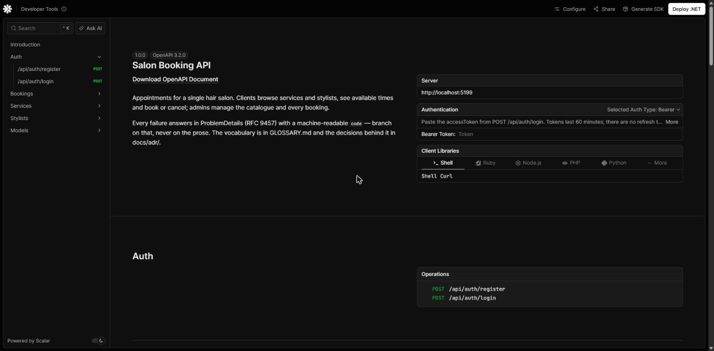
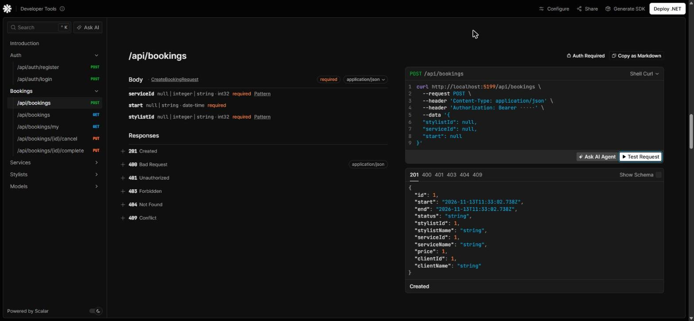
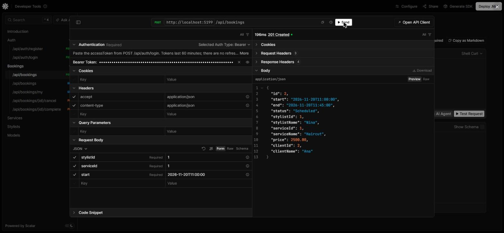
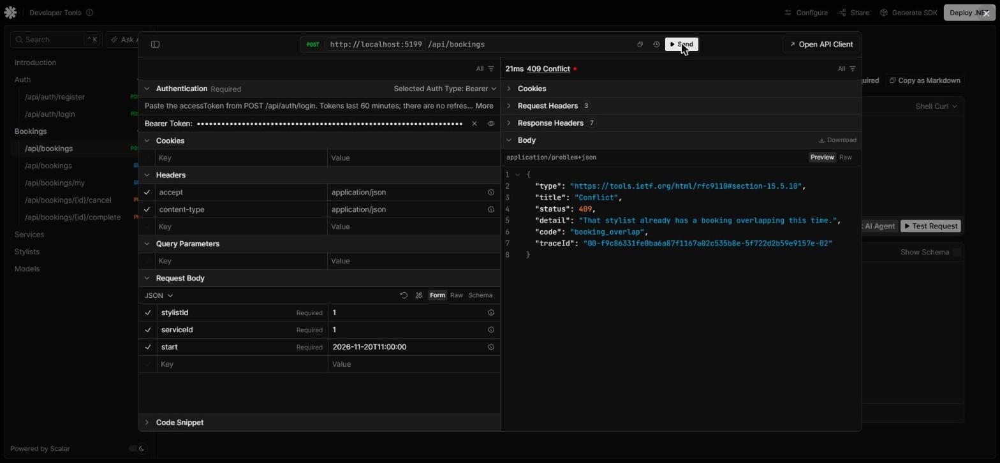

# Salon Booking API

REST API for a single hair salon. Clients browse services and stylists, see available times
and book or cancel appointments. Admins manage the catalogue and every booking.

**Start with [`GLOSSARY.md`](GLOSSARY.md) and [`docs/adr/`](docs/adr).** The glossary is the
vocabulary the code is written in — client, stylist, slot, active, scheduled — and the eight
ADRs are where the decisions that are not obvious from the code are argued: local wall-clock
time, a serializable transaction for overlap, no ASP.NET Core Identity, soft delete, one error
envelope. Nobody finds those by reading the controllers. The specification they implement is
[`.scratch/salon-booking/spec.md`](.scratch/salon-booking/spec.md).

Stack: C#, ASP.NET Core Web API, EF Core, SQL Server, xUnit. Targets `net11.0`.

## Projects

| Project                | What it is                                                      |
| ---------------------- | --------------------------------------------------------------- |
| `ZakazivanjeApi`       | The API. Folders: `Controllers/`, `Services/`, `Domain/`, `Data/`, `Entities/`, `Dtos/` |
| `ZakazivanjeApi.Tests` | xUnit tests                                                      |

Booking rules live in `Domain/` as classes that touch neither EF Core nor the database, so
they can be tested without one (ADR-0007).

## Prerequisites

- **.NET 11 SDK.** `dotnet --version` should report `11.*`.
- **SQL Server LocalDB**, as `(localdb)\mssqllocaldb`. It ships with the *Data storage and
  processing* workload in the Visual Studio Installer, or on its own as SqlLocalDB. Check with
  `sqllocaldb info mssqllocaldb`. Any other SQL Server will do — point the connection string at
  it. The integration tests need it too, and they name the instance themselves.
- **`dotnet-ef`**, only to apply migrations by hand outside Development:

  ```bash
  dotnet tool install --global dotnet-ef
  ```

## Setup

### 1. Secrets

**Nothing secret belongs in a tracked file — this repository is public** (ADR-0006). Locally,
the secrets go in user-secrets; everywhere else, in environment variables.

| Key              | What it is                                                     |
| ---------------- | -------------------------------------------------------------- |
| `Jwt:Key`        | The symmetric key tokens are signed with, 32 characters or more |
| `Admin:Email`    | Email of the first administrator, seeded at startup             |
| `Admin:Password` | That administrator's password, hashed before it is saved        |

```bash
dotnet user-secrets set "Jwt:Key" "<at least 32 characters>" --project ZakazivanjeApi
dotnet user-secrets set "Admin:Email" "you@example.com" --project ZakazivanjeApi
dotnet user-secrets set "Admin:Password" "<a password>" --project ZakazivanjeApi
```

As environment variables, the same keys are `Jwt__Key`, `Admin__Email` and `Admin__Password`.

`Jwt:Key` is required: without one — or with one shorter than 32 characters, which HMAC-SHA256
cannot use — the application refuses to start rather than issue tokens nobody can rely on. The
two `Admin` keys are optional; with neither set the application still starts, logs a warning and
seeds no administrator.

The non-secret half of the JWT configuration — issuer, audience and the 60-minute lifetime —
lives in `appsettings.json`.

### 2. Database

The connection string is `ConnectionStrings:SalonDb`. It is set, to LocalDB, in
`appsettings.Development.json` only — so **running as anything other than Development means
supplying it yourself**, as `ConnectionStrings__SalonDb`, alongside the three keys above. Which
environment you are is `ASPNETCORE_ENVIRONMENT`; `dotnet run` takes the `http` profile from
`Properties/launchSettings.json`, which sets it to Development.

In Development the application applies pending migrations at startup. Elsewhere, apply them
yourself:

```bash
ConnectionStrings__SalonDb="<your connection string>" \
  dotnet ef database update --project ZakazivanjeApi
```

Then seed: starting the application creates the configured administrator if no user holds
that email. Running it again changes nothing — an existing account is never overwritten.

Order matters outside Development, where the application does not migrate for you: apply the
migrations before the first start, or seeding will run against a schema that has no `Users`
table and the start will fail.

### 3. Browser origins

| Key                   | What it is                                            |
| --------------------- | ----------------------------------------------------- |
| `Cors:AllowedOrigins` | JSON array of origins a browser may call the API from |

Set, to the Vite dev server's `http://localhost:5173`, in `appsettings.Development.json`; as
environment variables the entries are indexed, `Cors__AllowedOrigins__0`. An empty or absent
list means "no cross-origin callers" and starts normally. The policy allows `GET`, `POST`,
`PUT` and `DELETE` with `Authorization` and `Content-Type`, and not credentials — the session
is a bearer token in a header, not a cookie. The frontend's dev server proxies `/api`, so
development never exercises any of it; it exists so the API is honestly consumable from a
browser on another origin rather than only from behind a proxy that hides the problem.

### 4. Run

```bash
dotnet run --project ZakazivanjeApi
```

Then open <http://localhost:5056/scalar> — see [API docs](#api-docs) below.

## Endpoints

Sixteen. `Client + Admin` and `Public + Admin` mean both, on different terms.

| Method | Route                                                 | Access         | Purpose                        |
| ------ | ----------------------------------------------------- | -------------- | ------------------------------ |
| POST   | `/api/auth/register`                                  | Public         | Create a client account        |
| POST   | `/api/auth/login`                                     | Public         | Return a JWT                   |
| GET    | `/api/services?includeInactive=`                      | Public + Admin | List the menu or the catalogue |
| GET    | `/api/services/{id}`                                  | Public         | Get one service, active or not |
| POST   | `/api/services`                                       | Admin          | Create a service               |
| PUT    | `/api/services/{id}`                                  | Admin          | Update or restore a service    |
| DELETE | `/api/services/{id}`                                  | Admin          | Deactivate a service           |
| GET    | `/api/stylists?includeInactive=`                      | Public + Admin | List the bookable or everyone  |
| POST   | `/api/stylists`                                       | Admin          | Create a stylist               |
| PUT    | `/api/stylists/{id}`                                  | Admin          | Update or deactivate           |
| GET    | `/api/stylists/{id}/available-slots?date=&serviceId=` | Public         | Free starts for a day          |
| POST   | `/api/bookings`                                       | Client         | Book an appointment            |
| GET    | `/api/bookings/my`                                    | Client         | List own bookings              |
| PUT    | `/api/bookings/{id}/cancel`                           | Client + Admin | Cancel a booking               |
| GET    | `/api/bookings?date=&stylistId=&page=&pageSize=`      | Admin          | List all bookings              |
| PUT    | `/api/bookings/{id}/complete`                         | Admin          | Mark completed                 |

The two list routes answer with the active rows only — the **menu** of services, the stylists
who can be booked — to everybody, and with the whole **catalogue**, what has been withdrawn
included, to an admin who passes `includeInactive=true` (`GLOSSARY.md` has the difference
between the menu and the catalogue). Admin only, because the catalogue is what an admin curates
and a client has no use for a service they cannot book. Anyone else passing it as `true` is
refused — `401` without a token, `403` with a client's — rather than quietly served the narrower
list: the API would otherwise answer a narrower question than the one it was asked, which is the
same position it takes on `page=0`. Passing `false` asks for what every caller already gets and
is refused to nobody. This is a deviation from the source specification, and the only way to
find a withdrawn service in order to put it back with `PUT /api/services/{id}` (ADR-0012).

Pagination returns `{ items, page, pageSize, totalCount, totalPages }`, defaulting to
`page=1, pageSize=20`, with `pageSize` capped at 100 rather than refused — the response says
which size was used. Ordering is `Start` then `Id`; without the tiebreak, equal-start bookings
can swap pages and a row gets duplicated or skipped.

Nothing reads one booking back by id, so `POST /api/bookings` sends no `Location` header. A
header pointing at a route that does not exist is worse than no header.

## Errors

Every refusal is `ProblemDetails` (RFC 9457), whichever layer refused it, and carries a
machine-readable `code` (ADR-0008):

```json
{
  "type": "https://tools.ietf.org/html/rfc9110#section-15.5.10",
  "title": "Conflict",
  "status": 409,
  "detail": "That stylist already has a booking overlapping this time.",
  "code": "booking_overlap",
  "traceId": "00-f9c86331fe0ba6a87f1167a02c535b8e-5f722d2b59e9157e-02"
}
```

**Branch on `code`. The `title` and `detail` are prose for a human and may be reworded at any
time.** A `400` carries `errors` with a field-by-field account on top of this envelope.

| Status | When                                                     | Codes                                                                                                                                                                    |
| ------ | -------------------------------------------------------- | ------------------------------------------------------------------------------------------------------------------------------------------------------------------------ |
| `400`  | The request is not well-formed                           | `invalid_request`                                                                                                                                                          |
| `401`  | No token, a bad one, or wrong credentials                | `unauthorized`, `invalid_credentials`, `invalid_token`                                                                                                                     |
| `403`  | A real caller without the role                           | `forbidden`                                                                                                                                                                |
| `404`  | No such route, or nothing the caller may see             | `not_found`, `booking_not_found`, `service_not_found`, `stylist_not_found`                                                                                                 |
| `405`  | Right route, wrong method                                | `method_not_allowed`                                                                                                                                                       |
| `409`  | Well-formed, but the current state forbids it           | `booking_overlap`, `booking_contended`, `outside_working_hours`, `start_in_past`, `stylist_inactive`, `service_inactive`, `cancellation_too_late`, `booking_already_cancelled`, `booking_already_completed`, `booking_already_scheduled`, `booking_not_started`, `email_taken` |
| `415`  | A body the endpoint cannot read                          | `unsupported_media_type`                                                                                                                                                   |
| `500`  | Something unforeseen                                     | `internal_error`                                                                                                                                                           |

Anything not listed above still carries a `code`, derived as `http_<status>`, so a client
branching on the field never meets a response without one.

A `500` carries no `detail`: an unhandled exception's message is the one string that could name
a table or a connection string, so it is logged server-side and dropped from the body. No stack
trace, exception message or connection string ever reaches a response body. The `errors` of a
`400` are the framework's own model-binding complaints, which can name a .NET type — those are
about the request you sent, and nothing about the server.

A booking belonging to someone else is a `404`, not a `403` — whether it exists is not the
caller's business.

## API docs

`Microsoft.AspNetCore.OpenApi` generates the document; [Scalar](https://scalar.com) is the UI,
since Swashbuckle left the template in .NET 9. Both are mapped in Development only — the
document describes every route the API has, which is for a reader running it locally and not
for the public internet.

| Where                | What                     |
| -------------------- | ------------------------ |
| `/scalar`            | The reference and client |
| `/openapi/v1.json`   | The document itself      |



Log in at `POST /api/auth/login`, paste the `accessToken` into **Bearer Token**, and every
locked endpoint is yours to try. Public endpoints are not locked, so it is clear at a glance
which need it.





Sending the same request twice shows the envelope on the way back:



## Working hours

Per weekday, in configuration, validated at startup so a malformed range fails the boot
rather than the first booking (ADR-0002). A weekday that is `null` or absent is a closed day.

```json
"WorkingHours": {
  "SlotGridMinutes": 15,
  "Days": {
    "Monday": { "Open": "09:00", "Close": "17:00" },
    "Saturday": { "Open": "09:00", "Close": "14:00" },
    "Sunday": null
  }
}
```

There is no public-holiday list and no per-stylist schedule; both are known gaps (ADR-0002).

## Time

All times are local salon wall-clock, never UTC (ADR-0001). "Now" always comes from an
injected `TimeProvider`, never `DateTime.Now`.

## Authentication

Hand-written JWT; ASP.NET Core Identity is deliberately not adopted (ADR-0006).

Registration always creates a **client**. There is no way to ask for a role, because a role
field in that payload would let anyone make themselves an admin; the first admin is seeded at
startup instead (ADR-0006).

Tokens last 60 minutes and carry `sub`, `email` and `role`. There are no refresh tokens — when
one expires, log in again. Send it as `Authorization: Bearer <token>`.

Login answers `401` with the same code and the same message whether the email is unknown or the
password is wrong, so the endpoint cannot be used to find out who has an account. Registering an
address that already exists answers `409` with code `email_taken`; addresses are compared
case-insensitively, so `nina@salon.rs` and `Nina@Salon.rs` are one account.

## Tests

```bash
dotnet test
```

Unit tests need nothing. The integration tests start the real application against LocalDB,
under a uniquely-named database that is migrated at the start of the run and dropped at the
end, so they need a working `(localdb)\mssqllocaldb`. They supply their own connection string,
JWT key and admin credentials last, so those win over anything your user-secrets hold and a
test run never touches your development database.
